=============================================
Building a Windows Server Image for OpenStack
=============================================

This guide describes, end to end, how to build a reusable Windows Server
image for an OpenStack cloud. The general approach is as follows:

#. Upload the official Windows installation media and the VirtIO driver
   ISO to the Image service (Glance).
#. Boot a temporary instance from a blank volume, attaching both ISOs as
   virtual CD-ROM devices.
#. Install Windows Server, the VirtIO paravirtualized drivers, the QEMU
   guest agent, the balloon (dynamic memory) service, and
   `Cloudbase-Init <https://cloudbase.it/cloudbase-init/>`_.
#. Generalize the installation with Sysprep and shut the instance down.
#. Detach the resulting volume and upload it to the Image service as a
   new, reusable Glance image.

Once published, this image can be used as the image source for any
future instance, and Cloudbase-Init will take care
of per-instance customization (administrator password, hostname, and
network configuration) on first boot.

Prerequisites
=============

* A Linux client machine (Debian, Ubuntu, RHEL, CentOS or AlmaLinux) —
  or Windows Subsystem for Linux (WSL), see `this example guide
  <https://destine-data-lake-docs.data.destination-earth.eu/en/latest/openstackcli/How-to-install-OpenStackClient-on-Windows-using-Windows-Subsystem-for-Linux-OpenStack-Hosting.html>`_
  used only to run the ``openstack`` command-line client; it does not
  need to be powerful, only network-reachable to the OpenStack API
  endpoints.
* Permission to manage security groups and floating IPs in the target
  project.
* A local machine with an RDP client to connect to the instance once it
  is reachable over the network.

Obtaining OpenStack Credentials
===============================

Before the openstack command-line client can be used, it needs
credentials for the target project. The Horizon dashboard can generate
these automatically.

Log in to Horizon, open the account menu in the top-right corner (or
navigate to **Project -> API Access** in some Horizon
themes), and download either the **OpenStack RC File** or the
**OpenStack clouds.yaml File**. Either one is sufficient; this guide uses
the RC file.

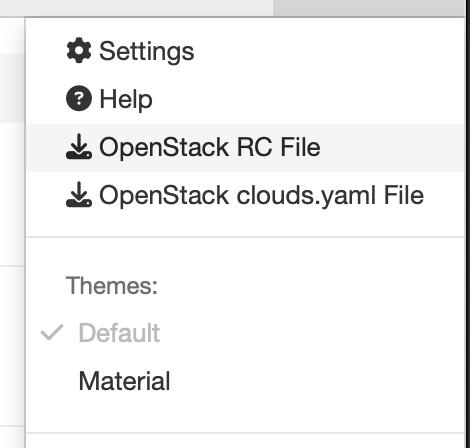

   Downloading the project credentials from the Horizon dashboard.

Copy the downloaded file to the Linux client and source it. You will be
prompted for the account password if it was not embedded in the file:

.. code-block:: bash

   # Example content of the downloaded RC file (values are placeholders)
   #!/usr/bin/env bash
   export OS_AUTH_URL="https://<keystone-endpoint>:5000/v3"
   export OS_PROJECT_ID="<project_id>"
   export OS_PROJECT_NAME="<project_name>"
   export OS_USER_DOMAIN_NAME="Default"
   export OS_PROJECT_DOMAIN_ID="default"
   export OS_USERNAME="<username>"
   export OS_REGION_NAME="<region_name>"
   export OS_INTERFACE=public
   export OS_IDENTITY_API_VERSION=3
   echo "Please enter your OpenStack Password for project $OS_PROJECT_NAME as user $OS_USERNAME: "
   read -sr OS_PASSWORD_INPUT
   export OS_PASSWORD=$OS_PASSWORD_INPUT

.. code-block:: bash

   source admin-openrc.sh

Installing the OpenStack Client
===============================

Install ``python-openstackclient`` on the Linux client used to run the
``openstack`` commands in this guide. The package is available from most
distributions' repositories, or from PyPI with ``pip``. Installing into a
Python virtual environment is recommended, so that the client and its
dependencies stay isolated from any system-managed Python packages:

.. code-block:: bash

   python3 -m venv ~/openstack-venv
   source ~/openstack-venv/bin/activate
   pip install python-openstackclient

Verify that the client can authenticate against the cloud:

.. code-block:: bash

   openstack image list

Preparing the Installation Media
================================

Two ISO images are required to build the instance:

#. The official Windows Server installation media. This guide uses
   Windows Server 2025, available from the `Microsoft Evaluation Center <https://www.microsoft.com/en-us/evalcenter/evaluate-windows-server-2025>`_.
#. The VirtIO driver ISO, which provides paravirtualized disk, network,
   and memory-balloon drivers for KVM/QEMU-based hypervisors. This guide
   uses `version 0.1.302 <https://fedorapeople.org/groups/virt/virtio-win/direct-downloads/archive-virtio/virtio-win-0.1.302-1/>`_.

Download both ISO files to the Linux client before continuing.

Uploading the Images to the Image Service
=========================================

With both ISOs on the client, upload them to Glance as private images so
they can be attached to the build instance as virtual CD-ROM devices.

Upload the Windows installer ISO:

.. code-block:: bash

   openstack image create \
     --disk-format iso \
     --container-format bare \
     --file <your_windows_installer.iso> \
     --private \
     "Win 2025 Installer"

Upload the VirtIO driver ISO:

.. code-block:: bash

   openstack image create \
     --disk-format iso \
     --container-format bare \
     --file virtio-win.iso \
     --private \
     "virtio-win"

Record the resulting image IDs (``openstack image list`` will show them);
they are needed in the next step.

Booting the Installation Instance
=================================

Boot a temporary instance from a blank volume, with the Windows installer
and the VirtIO driver ISO attached as CD-ROM devices. The blank volume
becomes the future system disk and uses the VirtIO SCSI/block bus
(``disk_bus=virtio``) so that it will require the VirtIO storage driver
during setup; the ISOs are attached on the IDE bus, which Windows Setup
can read natively without any extra drivers.

.. code-block:: bash

   openstack server create \
     --flavor <your_flavor_id> \
     --block-device source_type=blank,destination_type=volume,volume_size=50,disk_bus=virtio,boot_index=1 \
     --block-device source_type=image,uuid=<windows_installer_image_id>,destination_type=volume,volume_size=10,disk_bus=ide,device_type=cdrom,boot_index=0 \
     --block-device source_type=image,uuid=<virtio_win_image_id>,destination_type=volume,volume_size=2,disk_bus=ide,device_type=cdrom,boot_index=2 \
     --network <your_network_id> \
     Win-Install

Because ``boot_index=0`` is assigned to the Windows installer ISO, the
instance boots directly into Windows Setup. Wait for the instance to
reach the ``ACTIVE`` state, then open its console from Horizon
(**Compute -> Instances -> Win-Install -> Console**).

Installing Windows Server
=========================

The console should show the first screen of Windows Setup.

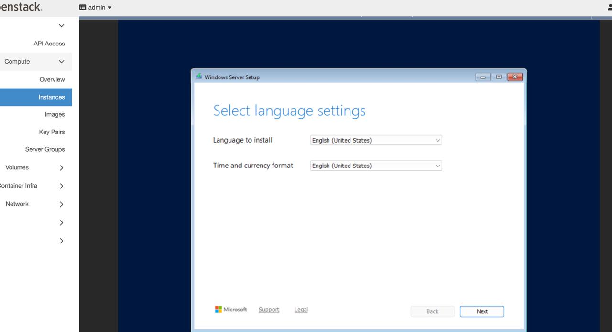

   The initial Windows Setup screen, reached automatically because the
   installer ISO was assigned ``boot_index=0``.

Proceed through the wizard: accept the default language and keyboard
settings, click **Install now**, select the desired Windows Server
edition, and accept the license terms. When Setup reaches the disk
selection screen, the list will be empty, because the system volume was
attached over the VirtIO bus and Windows does not ship a driver for it
by default.

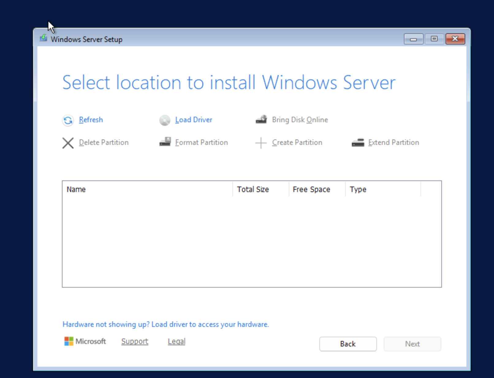

   No disks are visible yet: the VirtIO block driver has not been loaded.

Click **Load driver**, then **Browse**, and navigate on the VirtIO driver
CD-ROM (typically drive ``E:``) to the ``viostor`` directory that matches
the target Windows version and architecture, for example
``E:\viostor\2k25\amd64``.

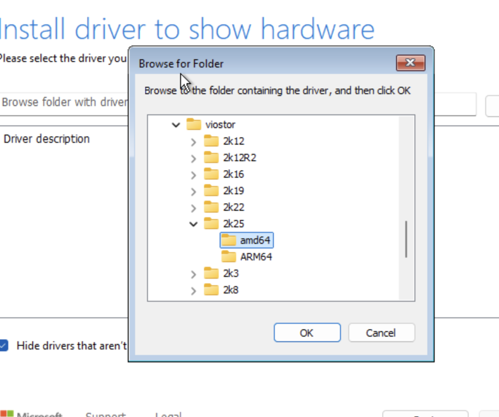

   Locating the ``viostor`` (VirtIO SCSI/block) driver on the VirtIO ISO.

Confirm the folder, select the listed VirtIO SCSI controller driver, and
click **Next** to install it. The blank system volume then becomes
visible as unallocated space.

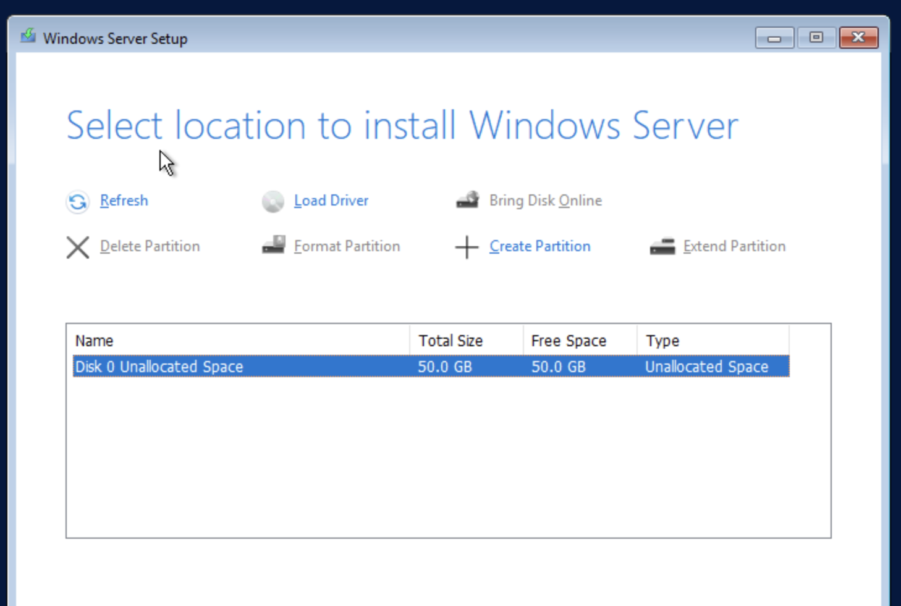

   The 50 GB system volume is now visible after the VirtIO driver has
   been loaded.

Select the disk, create a partition (or accept Setup's default layout),
and click **Next** to begin installation. Windows Setup copies files and
reboots the instance several times as part of the installation process;
this can take several minutes. When installation finishes, set the new
password for the local ``Administrator`` account and complete the first
sign-in.

.. note::

   Only the storage driver is required at this stage. The remaining
   VirtIO drivers (network, balloon, serial, and so on) are installed
   after the first successful logon, in the next section.

Installing the VirtIO Drivers
=============================

After signing in, open an Windows Command Prompt and install the
remaining VirtIO drivers from the driver ISO using ``pnputil``. Adjust
the version subdirectory (``2k25`` in the examples below) to match the
Windows Server version being installed.

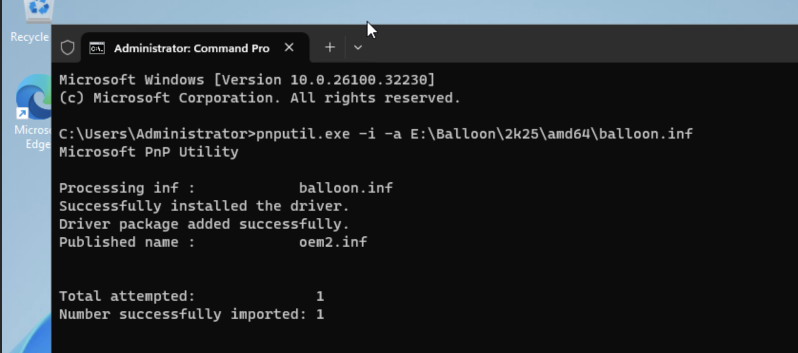

   Installing a VirtIO driver package with ``pnputil -i -a``.

.. code-block:: bat

   pnputil -i -a E:\Balloon\2k25\amd64\balloon.inf
   pnputil -i -a E:\NetKVM\2k25\amd64\netkvm.inf
   pnputil -i -a E:\pvpanic\2k25\amd64\pvpanic.inf
   pnputil -i -a E:\qemupciserial\2k25\amd64\qemupciserial.inf
   pnputil -i -a E:\vioinput\2k25\amd64\vioinput.inf
   pnputil -i -a E:\viorng\2k25\amd64\viorng.inf
   pnputil -i -a E:\vioscsi\2k25\amd64\vioscsi.inf
   pnputil -i -a E:\vioserial\2k25\amd64\vioserial.inf

Each invocation should report ``Successfully installed the driver`` and
``Driver package added successfully``.

Installing the QEMU Guest Agent
===============================

The VirtIO ISO also ships an MSI installer for the QEMU guest agent,
which allows the hypervisor to query guest status and issue commands
such as filesystem freeze/thaw for consistent snapshots. Run it from the
same elevated Command Prompt:

.. code-block:: bat

   E:\guest-agent\qemu-ga-x86_64.msi

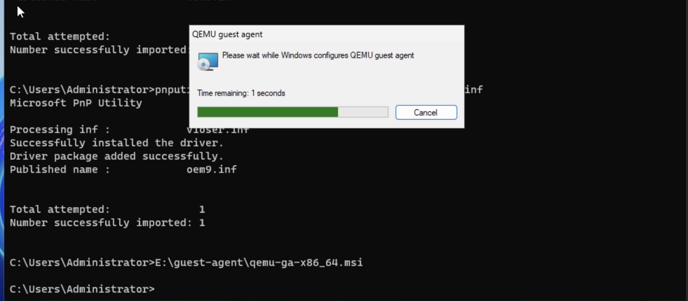

   The QEMU guest agent installing silently after the VirtIO serial
   driver has been loaded.

The installer runs with no further prompts and returns to the command
line once complete.

Installing the Balloon (Dynamic Memory) Service
===============================================

The balloon driver installed earlier exposes a virtual device, but the
companion **balloon service** (``blnsvr``) must also be installed so that
the guest can respond to memory ballooning requests from the hypervisor.
Copy the ``Balloon`` directory from the VirtIO ISO to a local path, for
example ``C:\Balloon``, and run the service installer from there.

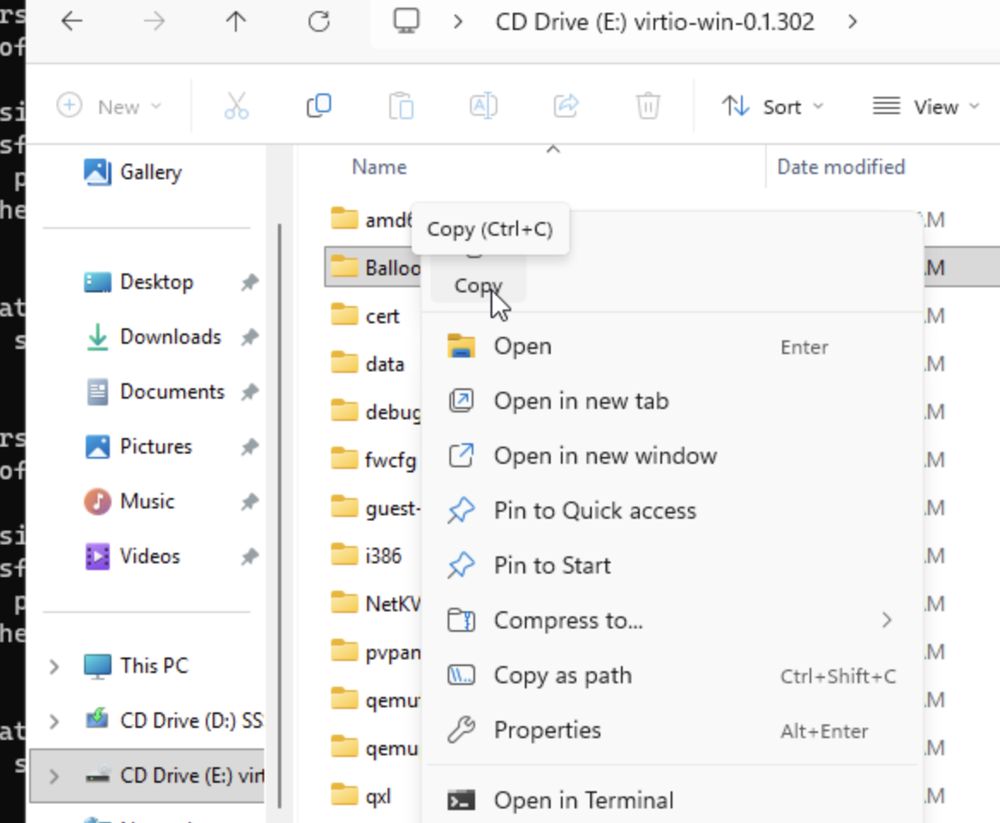

   Copying the ``Balloon`` directory from the mounted VirtIO ISO to local
   storage.

.. code-block:: bat

   C:\Balloon\2k25\amd64\blnsvr.exe -i

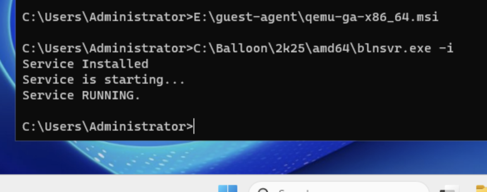

   The balloon service reports ``Service Installed`` and
   ``Service RUNNING``.

The service can be confirmed in Task Manager, listed as ``blnsvr`` with a
child process named ``Balloon Service``.

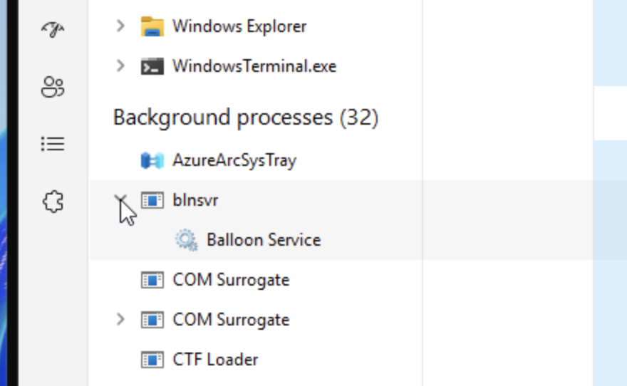

   The balloon service visible under Background processes in Task
   Manager.

Configuring Network Access
==========================

Reboot the instance so that all newly installed drivers, particularly
``netkvm``, are fully applied. After the reboot, the network adapter
should be recognized and, depending on the DHCP configuration of the
subnet, an IP address should be assigned automatically.

To reach the instance remotely, enable Remote Desktop from
**Settings -> System -> Remote Desktop**, toggle it on,
and confirm the prompt.

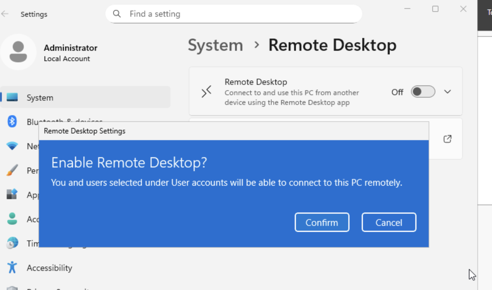

   Enabling Remote Desktop from Windows Settings.

Next, permit RDP traffic at the OpenStack network layer. In Horizon,
open the relevant security group and add a rule using the predefined
**RDP** template, restricting the ``CIDR`` field to the smallest range
that meets your access requirements rather than leaving it fully open.

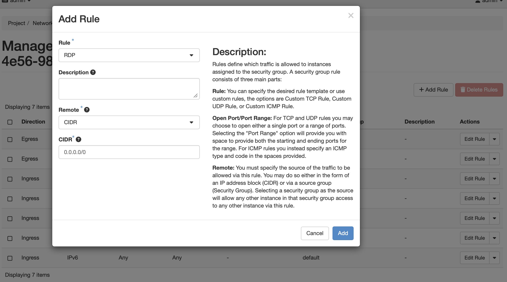

   Adding an RDP rule to the instance's security group.

Finally, associate a floating IP with the instance so that it is
reachable from outside the OpenStack project network, via
**Compute -> Instances -> Associate Floating IP**.

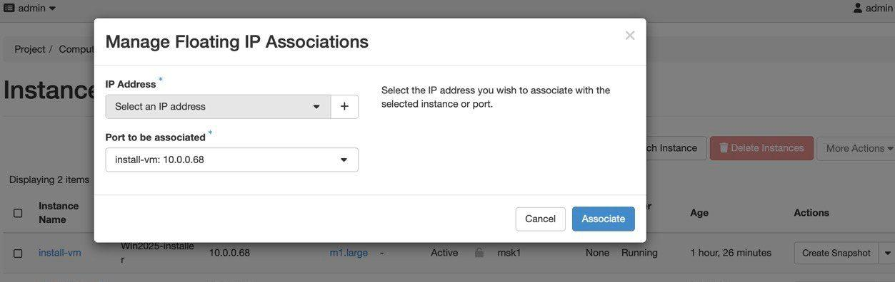

   Associating a floating IP address with the installation instance.

.. warning::

   Restrict the RDP security group rule to trusted source addresses.
   Exposing RDP to ``0.0.0.0/0`` is a common attack vector and should be
   avoided outside of build instances.

With the security group rule and floating IP in place, connect to the
instance using any RDP client and the ``Administrator`` credentials set
earlier.

Installing Cloudbase-Init
=========================

`Cloudbase-Init <https://cloudbase.it/cloudbase-init/>`_ is the Windows
equivalent of cloud-init: it reads instance metadata from the OpenStack
metadata service on first boot and applies settings such as the
administrator password, hostname, etc. Installing it is what
makes the resulting image reusable for many future instances, rather
than a one-off Windows installation.

From within the RDP session, download the `installer <https://cloudbase.it/downloads/CloudbaseInitSetup_Stable_x64.msi>`_.

Run the installer. On the configuration screen, set the username to
``Administrator``, enable **Use metadata password** so that the password
supplied by OpenStack at instance creation is applied on first boot, and
confirm that the user is a member of the **Administrators** local group.

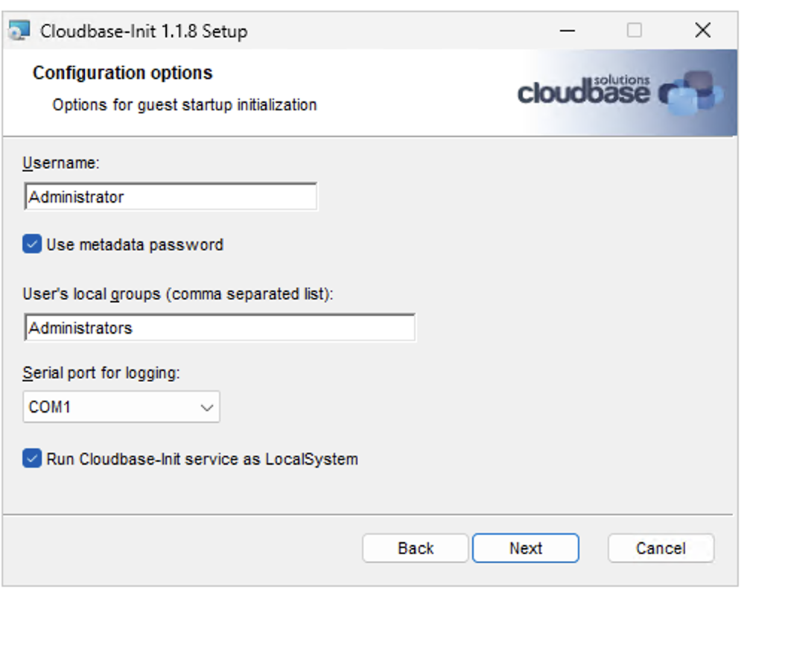

   Cloudbase-Init configuration: username, metadata password, and local
   group membership.

Complete the remaining installer screens with their default values.

Generalizing the Image with Sysprep
===================================

On the final screen of the Cloudbase-Init installer, select **Run
Sysprep to create a generalized image** and **Shutdown when Sysprep
terminates**, then click **Finish**.

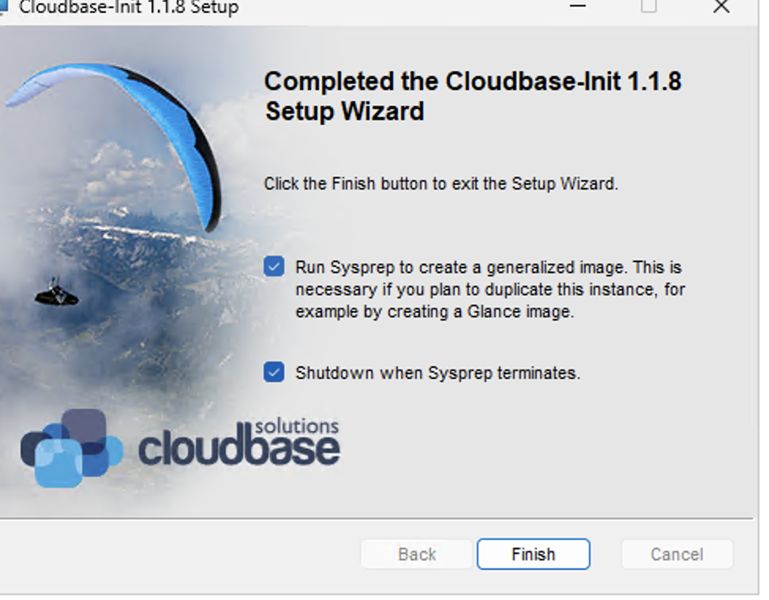

   Running Sysprep and shutting the instance down on completion, as the
   final step of the Cloudbase-Init installer.

Sysprep removes machine-specific state (security identifiers, computer
name, installed-driver associations, and so on) so that the image can be
safely duplicated into many independent instances. Once Sysprep
completes, the instance powers itself off; wait for Horizon to report
the instance as ``SHUTOFF`` before continuing.

.. note::

   Do not start the instance again after Sysprep has run and it has shut
   down. Booting a generalized instance would trigger a new,
   instance-specific specialization pass and effectively rebind the
   image to that one instance, defeating the purpose of the capture.

Publishing the Final Image
==========================

With the instance powered off, detach the system volume and capture it
as a new Glance image so it can be reused as a boot source.

In Horizon, go to **Project -> Volumes**, locate the
volume attached to the build instance, and choose **Manage Attachments**
from the volume's action menu.

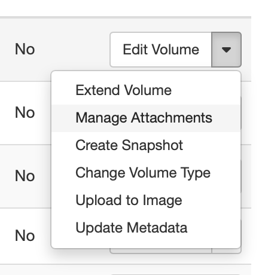

   The per-volume action menu in the Volumes list.

Detach the volume from the (now shut-off) instance. Once detached, open
the action menu again and select **Upload to Image**. Provide an image
name and choose the disk format appropriate for your storage backend
(for example, ``QCOW2`` for file-based backends or ``RAW`` for
Ceph-backed storage).

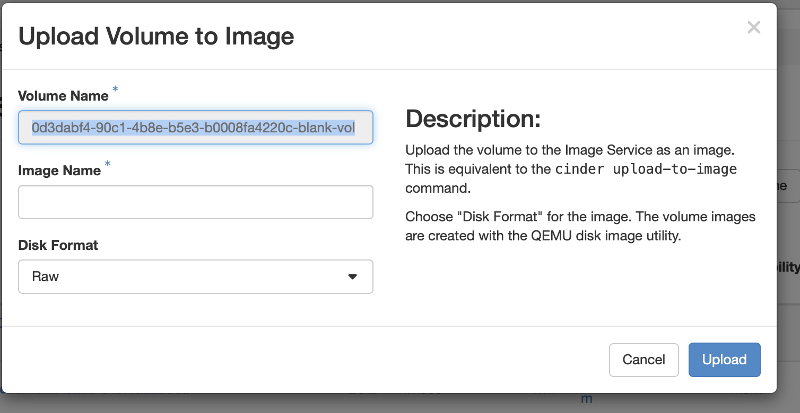

   Uploading the captured volume to the Image service as a new image.

Click **Upload** and wait for the operation to complete; Glance reports
the image status as ``queued``, then ``saving``, and finally ``active``.
This can take several minutes depending on volume size and storage
backend performance.

The image can now be referenced directly by UUID or name in
``openstack server create --image ...`` for any subsequent Windows
Server deployment, without repeating the manual installation steps
described in this guide.

For further tuning of Windows guests, see `Windows optimization tips
<https://docs.openstack.org/openstack-ansible-os_nova/latest/operational-tips/windows-optimization.html>`_.
